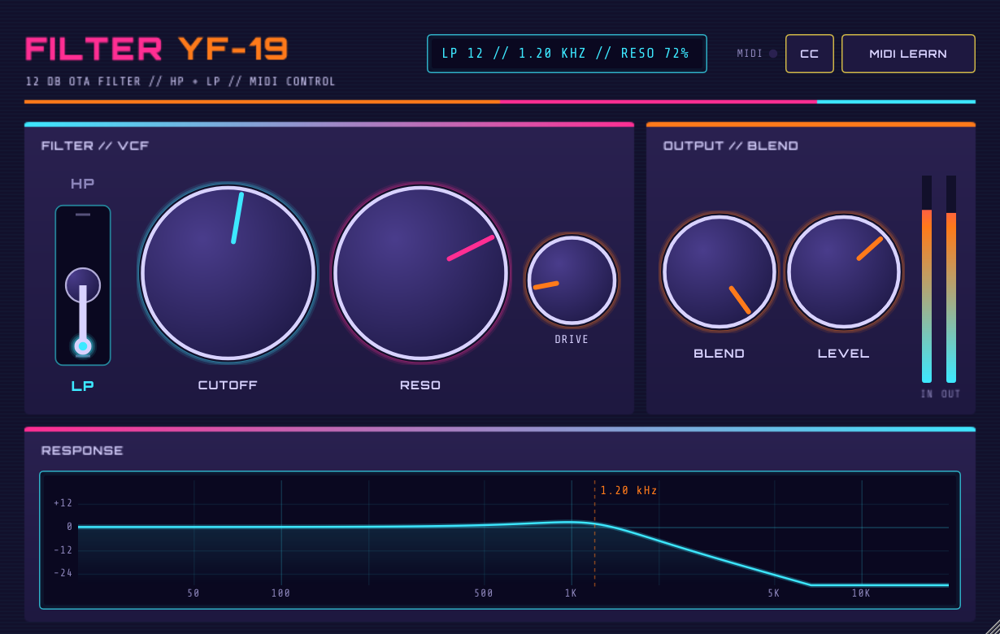

# Filter YF-19
A 12 dB OTA high-pass / low-pass filter effect with MIDI control of every knob (JUCE, VST3 + Standalone).
Same look as [Bassline YF-21](https://github.com/LexLongcoding/BasslineYF21) and Decu6000. Free and open source - see [License](#license).



## What it is
An insert filter for the FX slot after a synth, modelled on the circuit family of the **Blue Lantern
Spacemoth v2** Eurorack VCF: an MS-20 style 12 dB/oct OTA filter (Korg-35 topology) with a switch for
**HP / LP**. Its character comes from saturation *inside* the resonance loop: turn RESO up and the peak
grows teeth instead of just getting louder; near the top it self-oscillates, at a controlled level.

| Control | What it does |
|---|---|
| **HP / LP** switch | High-pass (up) or low-pass (down), both 12 dB/oct. Flipping it crossfades in ~12 ms, so it never clicks. |
| **CUTOFF** | 20 Hz - 20 kHz. Smoothed so knob moves, automation and stepped 7-bit MIDI CCs glide (no zipper noise). |
| **RESO** | Gentle in the lower half (a soft lift that suits pads), screaming near the top, self-oscillates at 100 %. |
| **DRIVE** | Level into the saturating loop - the module's trimmers, which ship "barely saturating". Low = clean. |
| **BLEND** | Dry / filtered mix. The dry path is delayed to match the filter exactly, so blending doesn't phase. |
| **LEVEL** | Output, -24 to +12 dB. |

The **RESPONSE** display draws the curve from the same DSP code the audio uses, including BLEND and LEVEL.
IN / OUT meters on the right.

## Why an insert filter fixes "the filter doesn't do anything" on some synth patches
On some patches a synth's own filter barely seems to work. Usually the sound is made *after* the filter
(the synth's reverb / delay / chorus tails, a distortion that brings the highs back), or the filter is
already driven by an envelope / key tracking that fights the knob, or the oscillators are layered or
noise-heavy. YF-19 sits in your DAW's FX chain **after the whole synth, effects included**, so it always
filters the finished sound.

For pads: start with RESO 15-35 %, DRIVE low, and sweep CUTOFF (LP for darkening, HP for thinning out a mix).
BLEND 60-80 % keeps some of the original body while the filtered part moves.

## MIDI control
Every control (the HP/LP switch too) can follow a MIDI CC:

- **Out of the box**: CC 74 -> CUTOFF, CC 71 -> RESO (the standard "brightness" / "timbre" CCs).
- **MIDI LEARN** (header): click a control, move a knob or fader on your controller. ESC exits.
  Or right-click any control -> *Learn MIDI CC...* / *Clear MIDI CC*.
- **CC** button: shows the current map; reset to defaults or clear all.
- The HP/LP switch: CC values 0-63 = LP, 64-127 = HP.
- The map is saved with your project. The **MIDI** light in the header blinks when CCs arrive.
- Your DAW's own automation and controller mapping work too - all six controls are normal plugin parameters.

**Getting MIDI to an effect in your DAW** - YF-19 is an audio effect that also accepts MIDI:
- **Reaper**: route a MIDI track (or the synth track's MIDI) to the FX; YF-19 on the synth track receives the track's MIDI.
- **Bitwig / Cubase / Studio One**: YF-19 shows up as a MIDI destination (or receives the track's MIDI) - pick it as the output of a MIDI track.
- **FL Studio**: in the plugin wrapper settings, set a MIDI input port, and send your controller on that port.
- **Ableton Live**: Live doesn't send MIDI to audio effects. Use Live's MIDI map (Ctrl/Cmd+M) on YF-19's parameters
  through "Configure", or the Standalone app.
- **Standalone**: Options -> Audio/MIDI Settings -> tick your controller.

## Building
Same as YF-21: CMake fetches JUCE 8.0.4.
```
cmake -B build -DCMAKE_BUILD_TYPE=Release
cmake --build build --config Release --parallel
```
Or push to GitHub: the included Actions workflow builds Windows and Linux downloads on every push
(Actions tab -> run -> Artifacts), and publishes a release when you run it with a version.

Tests: `cmake -B build -DYF19_BUILD_TESTS=ON`, then run `YF19DspTest` (filter core), `YF19Tests <folder>`
(plugin + screenshots) and `YF19HostTest "<path>/Filter YF-19.vst3"` (loads the VST3 like a DAW).

## License
GNU AGPL v3.0 or later - see `LICENSE` and `THIRD-PARTY-NOTICES.md`. Not affiliated with Blue Lantern
Modules or Korg; their names are used only to describe the circuit this is modelled on.
